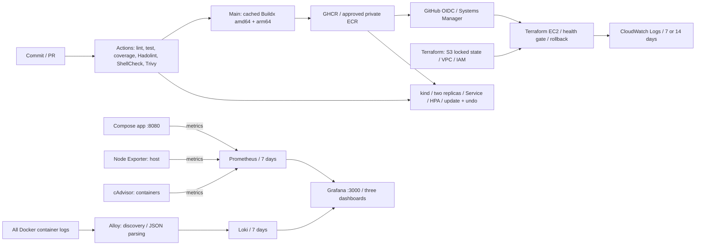
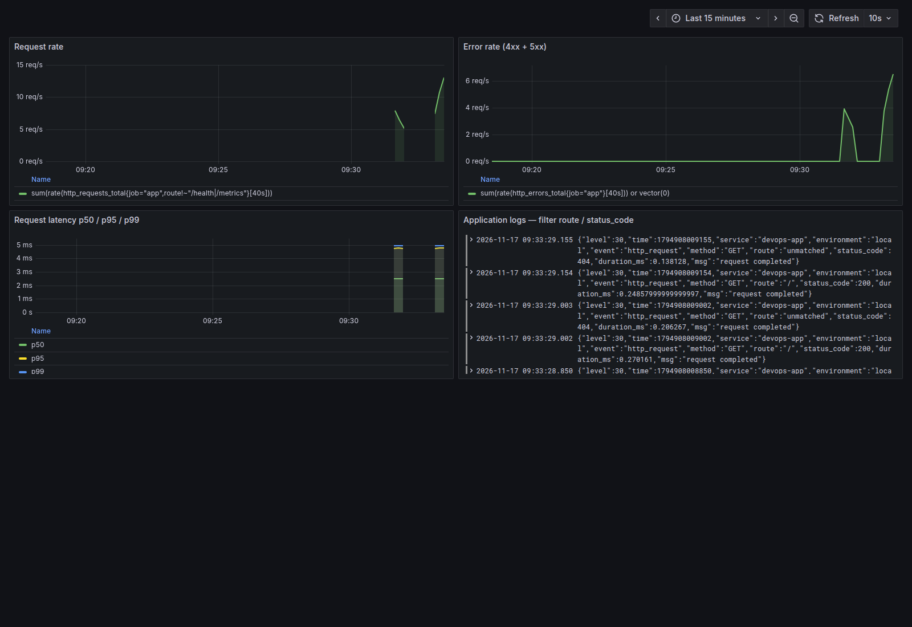
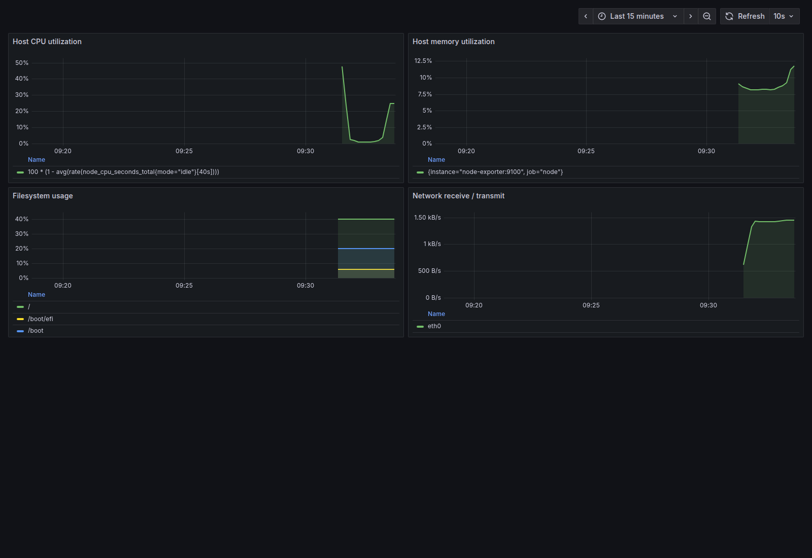
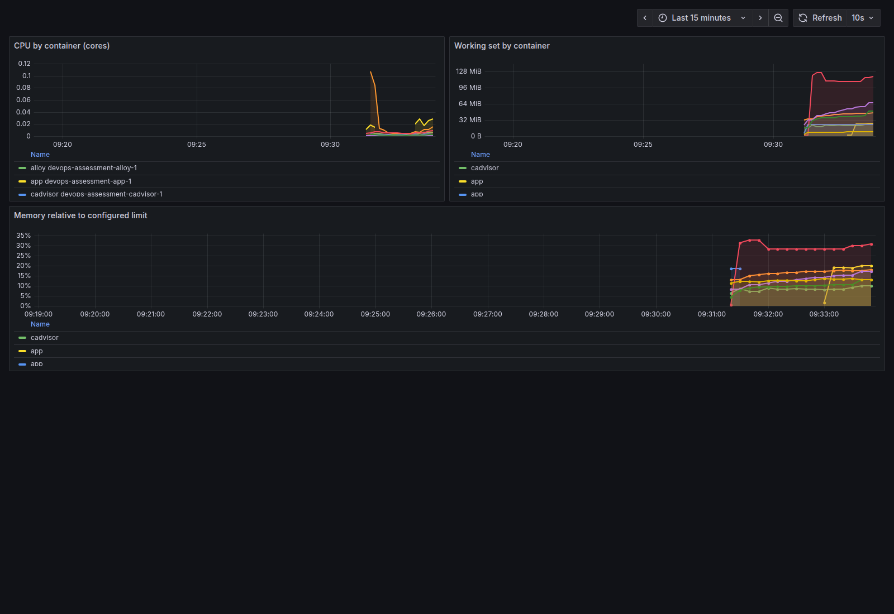

# DevOps Engineer Assessment

An Express service delivered through Docker, GitHub Actions, Terraform, Kubernetes, and a complete metrics and logs stack.

**Verified:** endpoint/lifecycle tests, coverage, image build/CRITICAL scan, kind deployment/update/undo/HPA, live monitoring, genuine dashboard screenshots, and scheduled Linux automation. **AWS plan/apply and EC2 deployment remain blocked on explicit owner approval and a temporary identity.** See the [compliance matrix](docs/COMPLIANCE_MATRIX.md), [final report](docs/FINAL_REPORT.md), [evidence](docs/evidence/README.md), and [Bengali handover](TECHNICAL_HANDOVER.md). Static Terraform validation is not an AWS apply.

## Architecture



EC2, local Kubernetes and Compose are alternative targets. The monitoring Compose stack observes its Docker host; EC2 container logs use CloudWatch. Monitoring is not automatically installed on EC2 or Kubernetes.

## Repository map

| Path | Purpose |
| --- | --- |
| `src/`, `test/` | Application, validated configuration, endpoint/lifecycle tests |
| `Dockerfile`, `docker-compose*.yml` | Hardened image, app and six monitoring services |
| `.github/workflows/` | PR verification and main release/deployment |
| `terraform/`, `terraform/bootstrap/` | Workload and protected state-bucket infrastructure |
| `k8s/` | Restricted Deployment, Service, ConfigMap, HPA and local overlay |
| `monitoring/` | Prometheus, Loki, Alloy and provisioned Grafana JSON |
| `system_health.sh`, `scripts/` | Collection, scheduling, deployment transaction and verification |
| `docs/evidence/`, `docs/screenshots/` | Actual results, provenance and genuine screenshots |

## Prerequisites

- Node.js **24**; image and CI use **24.22.3**. npm dependencies are exact and locked.
- Docker Engine, Compose v2 and BuildKit. For the full stack, allow roughly 4 GiB free RAM and 5 GiB disk. A Linux Docker host with working cgroup v2 is recommended.
- Kubernetes: kind **0.30.0**, kubectl **1.34.x** and Docker cgroup delegation. CI uses `kindest/node:v1.34.0`.
- AWS: Terraform **1.13.5** (>=1.10 supported), AWS CLI v2, owner approval for charges/IAM/cleanup, and approved temporary AWS/SSO authentication.
- Health script: Bash 4+, GNU coreutils/df, awk, procps ps and util-linux flock.
- Verification helpers: Python 3; screenshots additionally need Playwright **1.56.0** and Chromium/Chrome.

The managed coding environment has rootless Docker without systemd `Delegate=yes` or Docker cgroup delegation. Local kind creation failed and local cAdvisor cannot expose container limits. Both workloads passed on a standard GitHub-hosted Linux runner. See `kind-create.txt` and `local-monitoring-verification.json`; no local cluster success is claimed.

## Application: install, run and test

```bash
git clone https://github.com/Iftisam-sandik/devops-engineer-assessment.git
cd devops-engineer-assessment
npm ci --ignore-scripts
npm run lint
npm run test:coverage
PORT=8080 LOG_LEVEL=info ENVIRONMENT=local APP_VERSION=1.0.0 npm start
```

From another terminal:

```bash
curl -fsS http://127.0.0.1:8080/
# {"message":"Hello from DevOps Task!","status":"running","version":"1.0.0"}
curl -fsS http://127.0.0.1:8080/health
curl -fsS http://127.0.0.1:8080/metrics
```

| Variable | Default | Purpose |
| --- | --- | --- |
| PORT | 8080 | Integer 0..65535; 0 supports ephemeral test ports |
| LOG_LEVEL | info | Valid Pino log level |
| ENVIRONMENT | local | Environment in JSON logs/metrics |
| APP_VERSION | 1.0.0 | Response/release version |
| SHUTDOWN_TIMEOUT_MS | 10000 | Drain deadline before unfinished connections close |
| METRICS_TOKEN | empty | Optional bearer protection for /metrics; generated Secret in Kubernetes |

Metrics include `http_requests_total`, `http_errors_total` (4xx and 5xx), `http_request_duration_seconds` histogram and Node process metrics. Labels use normalized route templates; unknown paths become `unmatched`. Query strings, arbitrary IDs and authorization headers are not logged. SIGTERM/SIGINT marks readiness as draining, closes the listener, drains active requests and enforces a deadline.

**19 tests pass:** 100% lines/functions, 98.79% statements and 96.36% branches. CI enforces 90% lines/statements/functions and 85% branches and uploads LCOV/HTML. Tests cover exact response shape, metrics, healthy/draining states, token protection, 404/500 behavior, configuration and graceful/forced shutdown.

## Docker Compose

```bash
docker compose up -d --build
curl -fsS http://127.0.0.1:8080/health
docker compose logs -f app
docker compose down
```

The app binds loopback port 8080 and runs as UID 1000 with a read-only root filesystem, no capabilities, no-new-privileges, CPU/memory/PID limits, rotating logs and a Node-based health check. The 15-second container stop grace exceeds the 10-second drain deadline.

The final stage copies only Node, required shared libraries and production dependencies; npm/Yarn are excluded. The dependency base is pinned to `node:24.22.3-alpine3.24` and the final stage to `alpine:3.24.4`. The verified minimal amd64 image is **153,435,869 bytes (146.33 MiB, uncompressed)**; see [runtime inspection](docs/evidence/docker-runtime.json). Registry transfer size differs; metadata can change later build sizes. OCI labels identify source, version and revision; releases supply the exact SHA.

For TLS-inspecting environments, supply the trusted CA as a BuildKit secret, then reuse the built image:

```bash
docker build --secret id=proxy_ca,src=/etc/ssl/certs/ca-certificates.crt -t devops-assessment:1.0.0 .
docker compose up -d --no-build
```

The optional CA is available only during dependency installation and is not copied into image layers. TLS verification stays enabled.

## Observability startup

Generate local credentials without printing the password:

```bash
python3 - <<'PY'
from pathlib import Path
import secrets
p = Path('.env')
if p.exists():
    raise SystemExit('.env exists; preserve its configuration')
p.write_text('GRAFANA_ADMIN_USER=admin\nGRAFANA_ADMIN_PASSWORD='+secrets.token_urlsafe(32)+'\n')
p.chmod(0o600)
PY
docker compose -f docker-compose.yml -f docker-compose.monitoring.yml up -d --build
```

Open **http://127.0.0.1:3000**, log in as `admin` with the generated password from your private `.env`, then open **Dashboards → DevOps Assessment**. Data sources and dashboards are provisioned from repository files. Use `up -d --no-build` if the app is already built. For rootless Docker set `DOCKER_DATA_ROOT` in `.env` to the exact output of `docker info --format '{{.DockerRootDir}}'`; missing cgroup delegation can still prevent container metrics.

All six images are pinned. Prometheus scrapes app, host, cAdvisor and itself every ten seconds and retains **7 days**. Loki uses TSDB/filesystem storage and compactor retention of **168 hours**. Alloy discovers all Docker containers through the socket and forwards logs to Loki. App JSON level is a bounded label; route/status are structured metadata and queryable JSON fields. Service/container names identify this small deployment. No request IDs, user identities or query strings become Loki labels.

Only **Grafana** publishes a monitoring host port, on loopback. Other monitoring services communicate on an **internal** network; Grafana also joins a frontend network for its port. The app's 8080 mapping is separate. Internal names are appended to proxy exclusions while inherited external proxy settings are preserved.

### Dashboards and genuine screenshots

Application: request/error rates, p50/p95/p99 latency and adjacent Loki logs. Generated traffic includes real 404s; screenshots do not invent a production 5xx incident.



Host: CPU, memory, filesystem capacity and aggregate receive/transmit traffic by interface.



Containers: per-container CPU cores, working-set memory and percentage of configured limits. These screenshots come from the successful GitHub-hosted Docker run with real cgroups.



### Alerts and acceptance checks

| Alert | Condition | For | Reason |
| --- | --- | --- | --- |
| AppDown | App up == 0 | 1m | Persistent outage; tolerates brief restart |
| HighAppErrorRate | >5% 5xx and >0.1 requests/sec | 5m | Sustained failures; avoids idle-service noise |
| HostDiskAlmostFull | >80% filesystem usage | 10m | Capacity headroom; filters transient builds |
| ContainerMemoryNearLimit | >90% working set / finite limit | 5m | Investigate before OOM; tolerates allocation bursts |

```bash
docker run --rm --entrypoint promtool -v "$PWD/monitoring/prometheus:/etc/prometheus:ro" prom/prometheus:v3.5.0 check config /etc/prometheus/prometheus.yml
docker run --rm --entrypoint promtool -v "$PWD/monitoring/prometheus:/etc/prometheus:ro" prom/prometheus:v3.5.0 test rules /etc/prometheus/alerts.test.yml
python3 scripts/verify-monitoring.py --test-app-down --screenshots
```

For screenshots, install Playwright in a venv (`python -m pip install playwright==1.56.0`), then use installed Chrome/Chromium or `python -m playwright install chromium`. The verifier authenticates through Grafana, checks targets, host/container/app metrics, every service's logs, parsed JSON, provisioned dashboards and rules, stops the actual app until AppDown fires, restarts it, verifies recovery, and captures screenshots.

Promtool's four tests use specified synthetic series to evaluate real thresholds/pending durations. They are separate from the live AppDown outage/recovery. Notification routing is an optional bonus and is not configured.

### Error-spike investigation

1. On Application select the incident time range; compare traffic, error rate and p95/p99. The dashboard counts 4xx/5xx; the alert specifically counts 5xx.
2. Use the adjacent logs or Loki Explore: `{service="app"} | json | status_code >= 500`. Narrow a normalized route with `| route="/"`; inspect event, status, duration and error details.
3. Correlate Containers CPU/memory limits and Host CPU/memory/disk/network. Check `docker compose ps`, health status and recent releases.
4. Restore the previous immutable image if the release caused the regression. Kubernetes uses `kubectl rollout undo`; approved AWS deployments expose SSM output and CloudWatch logs.

### Host mounts and security trade-offs

Node Exporter mounts host `/` read-only at `/host` and uses host proc/sys paths as an unprivileged user. Propagation is omitted for non-shared-mount compatibility; new mounts can require a restart. cAdvisor mounts rootfs, sysfs, Docker data and socket, runs privileged, and uses the host cgroup namespace. No /dev/kmsg grant is made, so OOM event capture can be unavailable. Alloy runs as container root with capabilities dropped to access the socket, and stores positions in a named volume.

A read-only socket mount **does not restrict Docker API methods**. These agents are trusted host software; cAdvisor remains sensitive even with read-only mounts. Production should use an API-filtering socket proxy or dedicated host agents and isolate monitoring administration. The app has none of these host privileges.

## GitHub Actions

PR CI runs lint/tests/coverage, Hadolint, ShellCheck, Terraform checks, actual health-script cases, promtool tests, image build/Trivy, real kind rollout/undo/HPA, live monitoring and the five-minute systemd timer. Actions are pinned to commit SHAs. Trivy fails on **every CRITICAL finding, including unfixed vulnerabilities**; no ignore-unfixed or silent scan fallback is used. The final local full scan has zero CRITICAL/HIGH findings and one MEDIUM zlib finding (CVE-2026-4738); see the unfiltered report and fixed-version details in docs/evidence/trivy-full.json. This is not a claim of a vulnerability-free image.

Main calls the same checks, then QEMU/Buildx publishes **linux/amd64 and linux/arm64** with layer caching. Both published architectures must also pass the CRITICAL scan before deployment. GHCR gets `sha-<full-sha>` and a unique semantic prerelease such as `1.0.0-build.1.1`. ECR SHA tags also include run/attempt suffixes for immutable-tag reruns. Deployment uses the manifest **digest**, never latest.

| Setting | Type | Value/use |
| --- | --- | --- |
| GITHUB_TOKEN | Automatic Actions secret | GHCR authentication; no PAT needed |
| AWS_DEPLOY_ENABLED | Repository variable | Unset until approved setup; then exactly true |
| AWS_ROLE_ARN | Repository/production variable | Terraform github_role_arn |
| AWS_REGION | Variable | ap-south-1 |
| AWS_ECR_REPOSITORY | Variable | Terraform ecr_repository_url |
| AWS_INSTANCE_ID | Variable | Terraform instance_id |
| Grafana credentials | Local .env/runtime secret | Generated locally; independent ephemeral values in CI |

No AWS key secrets are used. During approved AWS onboarding, restrict the GitHub **production** environment to main deployments. OIDC trust is scoped to this repository/environment and sts.amazonaws.com. SSM command rights require assessment/environment tags. PR jobs get contents-read; publication gets package-write; AWS jobs get identity-token permission. Unset AWS enablement deliberately skips EC2 work and does not count as a successful AWS deployment.

## Terraform deployment

**Owner approval for resources, charges, IAM/OIDC and assessment-only cleanup plus temporary authentication is required before apply.** Review [AWS_APPROVAL_SCOPE.md](docs/AWS_APPROVAL_SCOPE.md). No AWS resources have been provisioned in the unauthenticated phase.

Credential-free validation:

```bash
terraform fmt -check -recursive terraform
terraform -chdir=terraform init -backend=false -input=false
terraform -chdir=terraform validate
terraform -chdir=terraform/bootstrap init -backend=false -input=false
terraform -chdir=terraform/bootstrap validate
```

After approval connect an AWS SSO/temporary identity, e.g. a configured `AWS_PROFILE=assessment` and `aws sso login --profile assessment`. Check `aws sts get-caller-identity` privately. Never put access keys in source, tfvars or chat.

### Remote-state bootstrap

Use a new globally unique, dedicated bucket:

```bash
export TF_VAR_state_bucket_name='YOUR-APPROVED-UNIQUE-BUCKET'
terraform -chdir=terraform/bootstrap init
terraform -chdir=terraform/bootstrap plan -out=bootstrap.tfplan
# Review the authenticated plan within the approved scope.
terraform -chdir=terraform/bootstrap apply bootstrap.tfplan
cp terraform/backend.hcl.example terraform/bootstrap-backend.hcl
```

Set its approved bucket and key `devops-assessment/bootstrap/terraform.tfstate` in that ignored HCL file. Copy `terraform/bootstrap/backend.tf.example` to ignored `terraform/bootstrap/backend.tf`, then migrate:

```bash
terraform -chdir=terraform/bootstrap init -migrate-state -backend-config=../bootstrap-backend.hcl
```

The bucket enables encryption, versioning, public-access blocking, TLS-only access and prevent_destroy. Terraform >=1.10 native S3 lock files provide locking without DynamoDB. Backend IAM should allow bucket listing, Get/Put on the exact state key, and Get/Put/Delete on its .tflock. Use separate bootstrap, staging and production keys.

### Workload

Copy the backend example to ignored `terraform/backend.hcl`, set the approved bucket and staging key:

```bash
terraform -chdir=terraform init -reconfigure -backend-config=backend.hcl
export TF_VAR_initial_image='REGISTRY/APP@sha256:APPROVED-PUBLISHED-DIGEST'
terraform -chdir=terraform plan -var-file=environments/staging.tfvars -out=staging.tfplan
terraform -chdir=terraform show staging.tfplan
terraform -chdir=terraform apply staging.tfplan
terraform -chdir=terraform output
```

The initial image must already be readable; a public repository does not make a GHCR package public. For private ECR bootstrap, use the approved temporary identity to apply **only** `aws_ecr_repository.app` first with `-target=aws_ecr_repository.app` and staging tfvars (supply a syntactically valid provisional initial image). Build/scan, authenticate with `aws ecr get-login-password`, push an assessment bootstrap image, resolve its digest using `aws ecr describe-images`, set TF_VAR_initial_image to that ECR digest, then run a **full** plan/apply. Targeting is only a one-time registry dependency bootstrap.

Resources: dedicated VPC/public subnet/IGW, no NAT gateway, encrypted 8 GiB EC2 disk, required IMDSv2, restricted SG, IAM instance profile, private immutable ECR, scoped GitHub OIDC role and CloudWatch log group. Ingress is denied by default; application_cidrs accepts approved sources for 8080, never 0.0.0.0/0. No SSH. SSM administration and smoke checks use outbound HTTPS. Bootstrap installs Docker, the health timer, CloudWatch logging and the approved app image. Logs retain 7 days in staging or 14 in production.

Production uses its tfvars and a **different state key**. Use an existing OIDC provider by default; set create_github_oidc_provider=true only after checking none exists and obtaining approval. The deployment role can publish to its ECR and send commands to tagged instances; it cannot apply Terraform or change IAM.

### Evidence and cleanup

Save authenticated plan/apply output, SSM deploy/rollback logs, health response and CloudWatch queries before cleanup. Check `cloud-init status --long` through SSM before enabling releases. The isolated unauthenticated plan attempt is recorded as blocked, not a clean AWS plan.

After approval to remove **only assessment-created resources**, remove this assessment ECR repository's images, run `terraform destroy -var-file=environments/staging.tfvars`, and verify no assessment instances remain. ECR force_delete=false prevents accidental image removal. Preserve evidence outside state storage. For a dedicated bucket only, remove object versions/lock files and its prevent_destroy guard as a reviewed cleanup before destroying bootstrap resources. Never delete a shared bucket or pre-existing OIDC provider.

## Deployment & Rollback Strategy

Verified main releases publish to ECR after approved setup. SSM runs root-owned /usr/local/bin/deploy-app, which obtains ECR credentials using the instance profile and invokes scripts/deploy.sh.

The transaction takes a flock, pulls before touching the current container, retains the previous container/image/config, starts the hardened candidate, and polls /health. Failure removes the candidate, restores/starts the previous container and checks recovery. CI fails even after a successful rollback. First deployment has no previous image. Single-instance EC2 replacement has brief downtime; zero downtime is demonstrated separately in Kubernetes. A production EC2 improvement is a load balancer with two targets.

**Actual local test:** initial version deployed; wrong-port candidate failed; ROLLBACK_SUCCEEDED appeared; previous version 1.0.0 returned healthy. See [transaction output](docs/evidence/deployment-transaction.txt). This tests real Docker rollback but does not assert AWS deployment success.

## Kubernetes deployment

```bash
kind create cluster --name assessment --image kindest/node:v1.34.0
docker build --build-arg APP_VERSION=1.0.0 -t devops-assessment:1.0.0 .
docker build --build-arg APP_VERSION=1.0.1 -t devops-assessment:1.0.1 .
kind load docker-image devops-assessment:1.0.0 devops-assessment:1.0.1 --name assessment
kubectl apply -f https://github.com/kubernetes-sigs/metrics-server/releases/download/v0.8.0/components.yaml
# Self-signed kind kubelet certificates only; do not use this exception in production.
kubectl -n kube-system patch deployment metrics-server --type=json -p '[{"op":"add","path":"/spec/template/spec/containers/0/args/-","value":"--kubelet-insecure-tls"}]'
kubectl -n kube-system rollout status deployment/metrics-server --timeout=180s
bash scripts/k8s-secret.sh
kubectl apply -k k8s/overlays/local
kubectl -n devops-assessment rollout status deployment/app --timeout=180s
kubectl -n devops-assessment port-forward service/app 8080:80
```

Use a free port if Compose already owns 8080. This is the PDF's permitted **port-forward alternative** to Ingress. Restricted Pod Security is enforced. Pods use UID/GID 1000, read-only rootfs, RuntimeDefault seccomp, no privilege escalation/capabilities and no service-account token. Requests: 100m CPU/64Mi; limits: 500m/128Mi. ConfigMap supplies non-sensitive config. scripts/k8s-secret.sh generates a random metrics bearer token through protected temporary files, applies a real Secret and removes the files. No production secret or base64 credential is committed; external secrets and encrypted etcd are needed in production.

HPA targets 70% requested CPU with 2..4 replicas and conservative scale-down. Metrics-server and actual CPU observations are required; merely creating HPA is insufficient.

### Executed update and rollback

```bash
bash scripts/k8s-rollout.sh devops-assessment:1.0.1
# Executes these while an in-cluster Service probe samples HTTP:
kubectl -n devops-assessment set image deployment/app app=devops-assessment:1.0.1
kubectl -n devops-assessment rollout status deployment/app
kubectl -n devops-assessment rollout undo deployment/app
kubectl -n devops-assessment rollout status deployment/app
```

Actual output includes:

```text
deployment.apps/app image updated
deployment "app" successfully rolled out
deployment.apps/app rolled back
deployment "app" successfully rolled out
```

maxUnavailable=0, maxSurge=1, readiness and minReadySeconds preserve two ready replicas. Probing the Service from inside the cluster follows changing endpoints instead of a disappearing port-forwarded pod. Full [rollout](docs/evidence/kubernetes-rollout.txt), [HTTP samples](docs/evidence/kubernetes-availability.txt), [HPA/pod metrics](docs/evidence/kubernetes-hpa.txt) and [provenance](docs/evidence/ci-provenance.json) are retained. They come from real kind execution on GitHub CI. After retaining evidence: `kind delete cluster --name assessment`.

### Production EKS changes

Use managed multi-AZ node groups, replica spreading, disruption budgets, VPC CNI/network policies, AWS Load Balancer Controller, ACM TLS and DNS. ECR pulls use node IAM; workload AWS access uses EKS Pod Identity or IRSA. Secrets Manager plus External Secrets/CSI, KMS encryption and scoped RBAC replace manual Secret generation. Add Karpenter/Cluster Autoscaler for nodes alongside HPA, durable monitoring, backups and alert routing. Do not carry the local insecure-kubelet-certificate flag into EKS.

## Linux automation

```bash
bash system_health.sh --help
bash system_health.sh --cpu 90 --mem 85 --disk 80 --critical 95
bash system_health.sh --json --log /tmp/health_log.txt
python3 scripts/test-health.py
```

Collects one-second CPU usage, memory, **all** mounted filesystems, load and top five memory processes. Zero-size and inherently read-only image filesystems are listed but excluded from capacity alerts. Warnings go to stderr so JSON stdout remains parseable. Thresholds trigger when usage **exceeds** the percentage; global critical defaults to 95 and must be >= warning thresholds.

Exit **0 healthy, 1 warning, 2 critical or collection/argument error**. In a set-e caller, explicitly capture expected warning exits. Reports append to timestamped health_log.txt (or --log), with three rotating backups by default. --max-log-bytes and --keep configure rotation; flock serializes writes/rotation, and umask 077 protects reports. A single report can exceed a tiny size setting; retention is bounded by the current report and configured backup count.

Install the real five-minute timer:

```bash
sudo useradd --system --no-create-home devops-health
sudo install -d /opt/devops-assessment
sudo install -m 0755 system_health.sh /opt/devops-assessment/
sudo install -m 0644 scripts/system-health.service scripts/system-health.timer /etc/systemd/system/
sudo systemctl daemon-reload
sudo systemctl enable --now system-health.timer
systemctl list-timers system-health.timer
journalctl -u system-health.service
```

systemd creates the writable state directory. Timer jitter is <=10 seconds; warning exit 1 is accepted and critical exit remains visible as failure. scripts/system-health.cron offers a five-minute cron alternative. [Timer evidence](docs/evidence/health-timer.txt) records an actual scheduled execution with exit 0, not a manual service start.

## Design Decisions

- **Alpine:** pinned compact runtime, built-in Node health check and practical debugging; multi-stage installation excludes dev dependencies.
- **EC2:** the requested simple, cost-conscious target. One failure domain is acknowledged; Kubernetes demonstrates rolling availability.
- **Tags/digests:** SHA and unique semantic tags aid review; digest deployment prevents tag races. Previous containers preserve rollback config.
- **SSM/OIDC:** no SSH port or static AWS keys; trust scoped to repository/environment and target tags.
- **S3 lock files:** supported by pinned Terraform; no extra DynamoDB table. Separate state keys isolate environments.
- **Bounded telemetry:** normalized routes/finite levels and detailed query-time JSON instead of user/request identity labels.
- **Local Loki/volumes:** reproducible assessment; production needs durable object storage, HA and restore testing.
- **Generated Secret:** meaningful protection of Kubernetes metrics without checked-in credentials; external secrets for production.

## Security Considerations

Application non-root/read-only execution, capability removal and resource limits reduce exposure. Generic errors avoid HTTP detail leakage; normalized telemetry avoids arbitrary path/query secrets. Tests contain an intentionally non-production token fixture. Dependencies/Actions are pinned and the final application image is scanned for CRITICAL findings. Grafana credentials are runtime-generated; internal monitoring APIs are not host-published. Exporter/socket privileges and their limits are documented above.

Terraform enforces encrypted state/disks, IMDSv2, restricted ingress and bounded logs. IAM scopes ECR/CloudWatch to assessment resources and action-scopes unavoidable wildcard token/channel APIs. The deployment role cannot change IAM/infrastructure. Direct EC2 HTTP is limited to approved source CIDRs; public production requires TLS/ALB or a trusted TLS proxy. State/plans remain private. Effective AWS IAM/network/CloudWatch behavior is unverified until an approved apply.

## Estimated monthly AWS production cost

Planning estimate for ap-south-1 and 730 hours; verify current AWS prices before use. Free-tier credits are not assumed.

| Item | Assumed USD/month |
| --- | ---: |
| t3.micro Linux EC2 | 10.00 |
| One public IPv4 | 3.65 |
| 8 GiB gp3 | 0.77 |
| Small CloudWatch logs volume | 1.00 |
| Small ECR/S3 storage and requests | 0.25 |
| **Total** | **15.67 (about 16)** |

Excludes taxes and substantial egress. T3 standard CPU credits avoid unlimited-mode credit charges but can throttle sustained load. No NAT gateway or ALB is provisioned. Production TLS/high availability or EKS raises cost. Monitoring is local and excluded from this estimate.

## What I would improve with more time

Complete approved AWS verification first; then add TLS/two deployment targets, protected release environments and branches, Docker API filtering, managed secrets, alert routing/runbooks, multi-AZ EKS policies, backup/restore drills and longer soak/load tests. Optional tracing, Helm, Ansible, signing/SBOM, Alertmanager and Kubernetes monitoring were deferred while mandatory acceptance evidence took priority.

## AI usage

OpenAI Codex assisted with code, configuration, tests, troubleshooting and documentation. Commands/Actions actually ran; results and screenshots are genuine. AWS gaps are explicit. The applicant should personally review the code and Bengali handover, reproduce the checks and be able to explain the submission; independent unaided authorship is not claimed.
